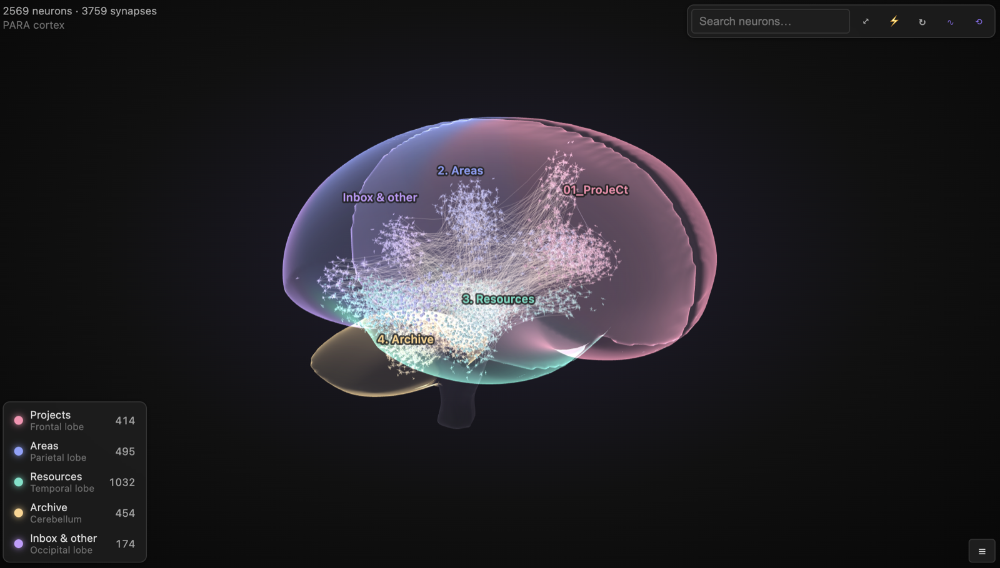
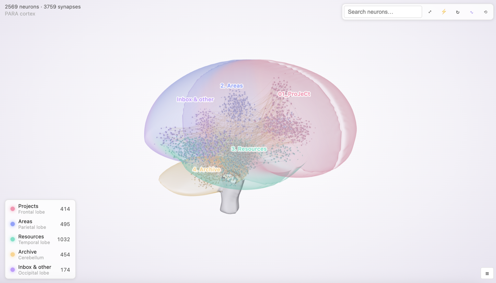
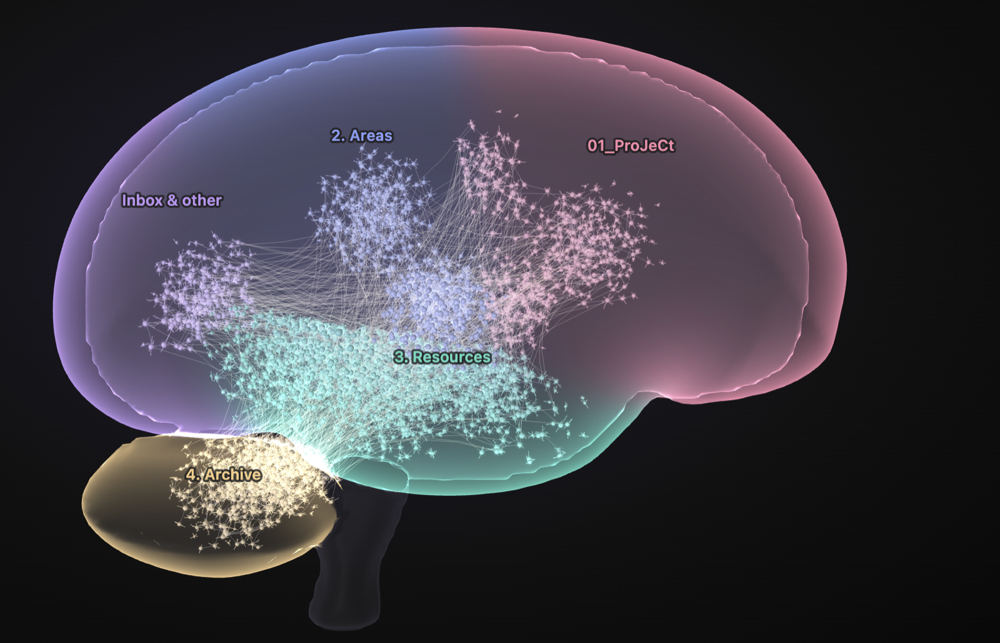
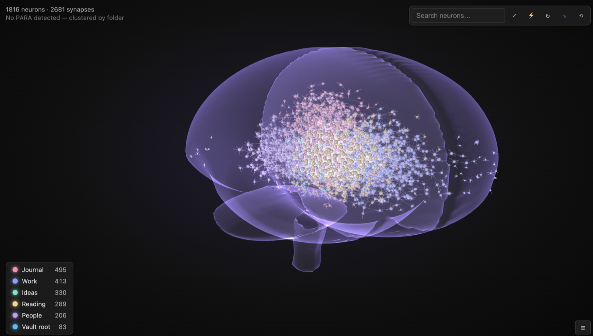

# Brain Graph for Obsidian

See your vault as a living brain. Every note is a **neuron** and every link is a **synapse**. Signals (action potentials) travel along the links and set off cascades through your knowledge.



| Light theme | Focused on one lobe | Without PARA folders |
|---|---|---|
| [](docs/images/brain-light.png) | [](docs/images/brain-focus.png) | [](docs/images/brain-free.png) |
| The same 2,569 notes; the scene follows your Obsidian theme. | Click a legend row to fly to that lobe. | 1,816 notes and 2,681 links, clustered by folder across the whole brain. |

<sub>Screenshots from the browser demo (`npm start`) with a generated test vault.</sub>

## PARA → cortex mapping

If your vault uses [PARA](https://fortelabs.com/blog/para/), each category gets its own region of the brain:

| PARA folder | Brain region | Why |
|---|---|---|
| **Projects** | Frontal lobe | Planning, goals, executive action |
| **Areas** | Parietal lobe | Ongoing integration and responsibility |
| **Resources** | Temporal lobe | Memory and knowledge |
| **Archive** | Cerebellum | Long-term, automatic storage |
| Inbox / other | Occipital lobe | Incoming sensory input |

PARA is detected automatically when at least two PARA folders sit side by side, either in the vault root or nested (for example `PARA/1. Projects`).

Each category is matched with a case-insensitive regular expression on the folder name. The defaults accept any numbering, separator or emoji prefix, any casing, and singular or plural forms: `01_ProJeCt`, `1. Projects`, `2-AREAS of focus`, `🗄 Archives` and `Archived` all match, but `Projectile` doesn't. You can edit the patterns in settings. An invalid pattern is flagged there and matched as plain text until you fix it.

The labels on the brain show the actual folder names.

**Colors** are configurable in settings. Pick a scheme (Nebula, the default; Ocean, Sunset, Forest, Monochrome violet, or Classic), or set a custom color for each PARA category. The lobes, their neurons, the labels and the legend all follow it, and lobe colors blend softly where two lobes meet. Changing colors repaints the brain instantly, without re-laying it out.

Each subfolder (for example `Projects/Website`) forms its own cluster ("gyrus") inside its lobe. A link between lobes is drawn as a long white-matter tract.

Without PARA, neurons spread across the whole cerebrum, clustered and colored by top-level folder.

## Interactions

The brain is fully 3D: a translucent shell tinted by lobe, with neurons, synapses and signals inside it.

- **Drag** the background to rotate, **Shift-drag** (or middle-drag) to pan, and scroll or pinch to zoom toward the cursor. Double-click empty space to fit the brain.
- It **auto-rotates** slowly when idle. Toggle this with ⟲ in the toolbar or in settings.
- **On touch:** drag to rotate, pinch to zoom, two fingers to pan. Tap a neuron to select it, tap it again to open the note, and long-press it for the menu.
- **Hover** a neuron to highlight its synapses; it keeps firing into its neighbors.
- **Click** to fire a cascade and open the note (Cmd/Ctrl-click opens it in a new tab).
- **Drag a neuron** to move it in the screen plane. It can't leave its lobe.
- **Right-click** for Open / Open in new tab / Fire / Fly to neuron.
- **Search** box: matching neurons are highlighted; Enter flies to the best match.
- **Legend**: click a lobe to fly to it.
- The note you have open glows and fires when you switch to it.
- **Keyboard**: click the brain (or Tab to it), then use the arrow keys to rotate, Shift + arrows to pan, + / − to zoom, F to fit and R to toggle auto-rotate. `/` jumps to the search box. The toolbar buttons and legend rows are regular buttons, so Tab, Enter and Space work on them too.
- The scene's background and label colors follow your Obsidian theme, including community themes.

## Development

```bash
npm install
npm start       # browser demo at http://localhost:5173 (live reload)
npm test        # domain, application, adapter and architecture tests
npm run dev     # watch build of the real plugin (main.js)
npm run build   # type-check + tests + production build (fails past the main.js size budget)
npm run lint    # Obsidian's plugin-review rules + the layering rules
```

### Architecture

The code uses domain-driven design with ports and adapters. Imports only point inwards. See [`architecture/service-brain-graph.md`](architecture/service-brain-graph.md) for the full design.

```
src/
  bootstrap/        composition root: container.ts (shared), plugin.ts (Obsidian entry)
  domain/
    contracts/      entities, value types, inbound service contracts
    interfaces/     outbound ports: VaultRepository, SettingsRepository, WorkspaceGateway, ContextMenuGateway
    model/          pure rules: anatomy/ (side-view outlines inflated into a 3D volume, lobes), connectome/ (PARA, neurons), dynamics/ (3D layout, firing)
  application/
    services/       use cases: grow and sync the brain, settings
    controllers/    orbit camera (pure math) and interaction state; input in screen coordinates, scene() out
    mappers/        palette, legend, tooltip and stats view models
  infrastructure/
    obsidian/       adapters for Obsidian's API, the ItemView shell and the settings tab
    webgl/          three.js renderer: marching-cubes brain shell, instanced neurons, label overlay
    dom/            the framework-free panel (toolbar, legend, tooltip, frame loop)
    in-memory/      twins of every port, used by the tests and the demo
```

`src/architecture.spec.ts` enforces the layering. It fails the build when a layer imports outward, when `obsidian` is imported outside its adapters, when `three` is imported outside `infrastructure/webgl`, or when `domain` or `application` code touches the DOM.

### Browser demo (`npm start`)

The demo runs the real composition root (`src/bootstrap/container.ts`) with the in-memory and plain-DOM adapters, so Obsidian isn't needed and nothing is mocked. The notes come from a generated fake vault (`demo/fake-vault.ts`). Any edit under `src/` or `demo/` rebuilds and reloads the page.

The side panel lets you:
- pick a vault structure (PARA in the root, nested PARA with emoji names, or no PARA)
- set the vault size (up to 20×, about 6k notes) and generate a new random vault
- add a note at runtime
- change every plugin setting
- switch between dark and light theme
- remount the view

Your setup is saved in the URL hash, so it survives reloads. Clicking a note shows a toast where Obsidian would open the file. Add `?nolive` to the URL to turn off live reload, for example when taking headless screenshots. Add `?loseContext=2000,1000` to simulate losing the GPU context after 2 s and restoring it 1 s later; leave off the second number to keep it lost.

### Installing into a local vault

```bash
npm run link:vault -- /path/to/vault   # development: relative symlink to this repo
npm run deploy -- /path/to/vault       # real copy of main.js, manifest.json, styles.css
```

Both enable **Brain Graph** in the vault's `community-plugins.json`. With the link, `npm run dev` rebuilds straight into the vault; toggle the plugin off and on in Obsidian to load the change. Use the copy when the vault is synced to other devices, since a synced symlink points nowhere there.

## Roadmap

### Goal: mobile support

The plugin is meant to work in the Obsidian phone and tablet apps too. `isDesktopOnly` is `false` and it uses no Node or Electron APIs. Touch input, the lighter mesh and the compact layout are implemented and unit-tested, but **nothing has been run on a real device yet**.

- [x] **Pinch to zoom and two-finger pan.**
- [x] **Tap to select, tap again to open.** The first tap shows the tooltip and highlights the neuron's synapses; a second tap on it opens the note. Tapping empty space clears the selection.
- [x] **Long-press for the context menu.**
- [x] **Larger touch targets:** a finger-sized hit area on the brain, and 40 px toolbar buttons and legend rows on touch devices. A one-finger drag always rotates, even when it starts on a neuron (neurons can't be dragged by touch).
- [x] **A lighter brain mesh on mobile:** the shell is built at 96³ instead of 128³ (about 40% less work), and the render pixel ratio is capped at 2.
- [x] **A compact toolbar and legend** for panels narrower than 560 px: the search box stretches, and the legend sits behind a toggle button.
- [ ] **Testing:** try the browser demo with `?mobile` in the URL and your browser's device emulation (it forces the mobile mesh and layout), then a real phone and tablet, installed with `npm run deploy` (a symlink doesn't sync to the phone).

## License

[MIT](LICENSE) © 2026 David Peled
