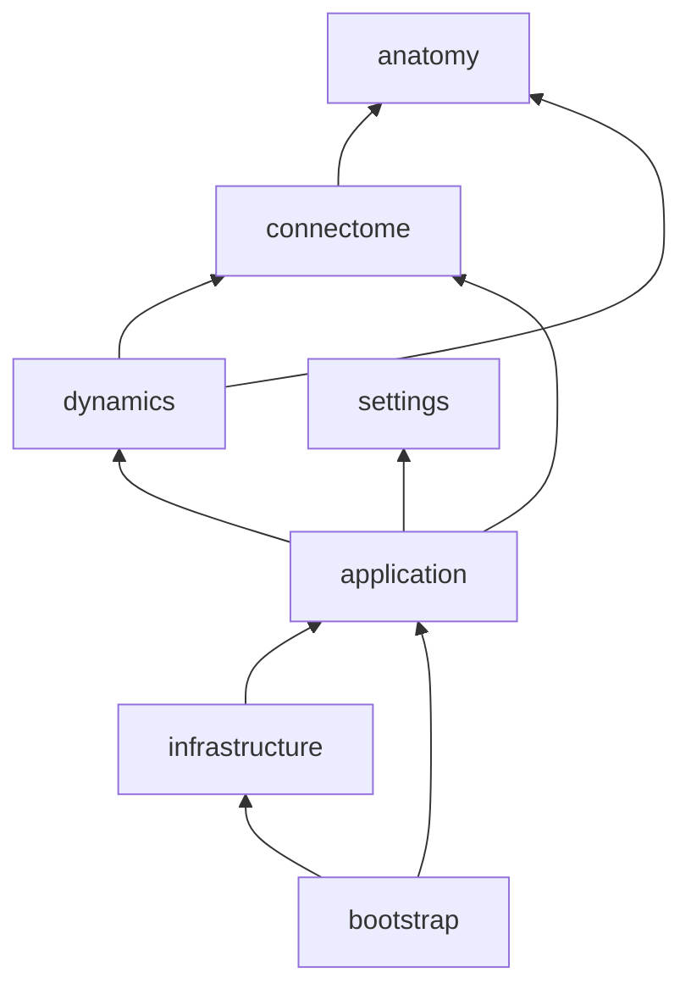

# Service Design: Brain Graph
- Owner: David Peled · Status: implemented · Style: folders with a composition root (no IoC library; a factory function wires everything)

## 1. Purpose and boundaries
Shows an Obsidian vault as a brain: notes are neurons, links are synapses, PARA folders map to brain regions. Signals travel along synapses.

- **Consumers:** the Obsidian plugin (`src/bootstrap/plugin.ts`) and the browser demo (`demo/main.ts`). Both go through the same composition root.
- **Upstream:** the vault (notes, folders, resolved links), the workspace (the open note, opening notes) and the host UI (theme, icons, context menu).
- **Non-goals:** editing notes, storing anything apart from settings, a server side.

## 2. Modules (bounded contexts)
This is one deployable plugin. The bounded contexts are folders inside `domain/model/` rather than separate packages; see §10.

| Context | Owns | Uses | Notes |
|---|---|---|---|
| **anatomy** | Side-view outlines and lobe classification; `BrainField`/`RegionVolume`, which inflate the outlines into two rounded hemispheres plus the cerebellum and brainstem (3D point to region, sampling, anchor spreading, the surface field) | — | Pure geometry; the renderer only polygonises `surface()` |
| **connectome** | Neurons, synapses, PARA detection, the cortex mapping (PARA category to region), dendrite growth | anatomy (region ids) | Built from a `VaultSnapshot` |
| **dynamics** | Brain sizing (by volume), neuron placement, the lobe-confined 3D layout simulation (hashed spatial grid), action potentials (firing and cascades) | anatomy, connectome | Mutable per-neuron state: 3D position, velocity, activation |
| **settings** | `StructureSettings` only (layout mode, PARA patterns, exclusions, orphans): the settings that decide which neurons exist and where they live | — | Display preferences live in the application layer |

## 3. Dependency graph

Imports only point inwards: `infrastructure` → `application` → `domain`. Only `bootstrap` picks concrete adapters.

## 4. Per-module design

### Domain (`src/domain`)
- `contracts/`: entities and value types (`Neuron`, `Synapse`, `Connectome`, `VaultSnapshot` (notes carry an optional `created` time, `Neuron.created` is 0 when unknown), `StructureSettings`, region constants, `Pulse`) and the inbound contract `BrainGraphService`. Its `BrainState` exposes the running brain through the interfaces `BrainVolume`, `BrainLayout` and `BrainFiring`, which the model classes (`RegionVolume`, `LayoutSimulation`, `ActionPotentials`) implement, so contracts never import the model.
- `interfaces/` (outbound ports):

  | Port | Purpose |
  |---|---|
  | `VaultRepository` | `snapshot()`, `onChange()` |
  | `SettingsRepository` | `load()`, `save()` of opaque JSON; the settings service validates it |
  | `WorkspaceGateway` | active note, `openNote(path, mode)`, active-note changes |
  | `ContextMenuGateway` | `show(actions, at)` |

- `model/`: the rules. The invariants:
  - A neuron is only ever placed in, and moved within, the 3D regions in its `allowed` bitmask, including never sitting in the fissure between the hemispheres. Placement guarantees it, the simulation enforces it on every axis of every step, and dragging refuses illegal positions.
  - PARA is used in `auto` mode only when at least two categories sit side by side, at depth 3 or less, with ties going to the shallowest folder.
  - Links are undirected and de-duplicated, with no self-loops; unresolved targets are dropped.
  - All randomness is injected (`RandomSource`). Layout seeds come from the vault name, so the same vault grows the same brain.

### Application (`src/application`)
- `contracts/`:
  - `settings.ts`: `DisplaySettings` (firing, labels, auto-rotate, colors), `PluginSettings` (structure + display) and the `SettingsService` contract;
  - `color-presets.ts`: the color schemes;
  - `scene.ts`: the renderer read model (see below).
- `services/brain-graph.service.ts`: the use cases *grow brain* and *keep it in sync*.
  - It holds one vault and settings subscription for all watchers.
  - It skips rebuilds when the vault fingerprint (notes, folders, links) is unchanged.
  - When it does rebuild, it carries positions, signals and activation across by note path.
  - It applies scale hysteresis and caches region volumes per scale (a per-process cache shared by every view, at most 5 sizes).
- `services/settings.service.ts`: sanitizes stored settings over the defaults (unknown keys, wrong types and non-finite numbers fall back), persists every update, and tells listeners whether a change was structural.
- `controllers/orbit-camera.ts`: a perspective orbit camera as pure math (project, unproject, orbit, pan, dolly, fit). Picking, neuron dragging and labels all use it, so they are unit-tested; the WebGL renderer copies its pose into three.js.
- `controllers/timeline.ts`: the brain's history. A playhead over the notes' creation times (the sorted times give the count of born notes in O(log n)); neurons grow in as it passes their date. It implements the `Presence` contract, so `FrameBuffer` depends on that and not on playback. Commands (toggle, play/pause, seek) live on `BrainController`, which also keeps unborn neurons out of picking, random firing, search fly-to and legend focus.
- `controllers/highlight.ts`: hover, search and focus. It tracks the hovered note by path across rebuilds and keeps a `version` that bumps when the focus changes.
- `controllers/pointer-interaction.ts`: the pointer state machine (neuron drag, orbit, pan, click, hover, cancel) behind a narrow `PointerHost` interface.
- `controllers/brain.controller.ts`: composes the camera, `Highlight` and `PointerInteraction`, and owns the graph lifecycle, palette, auto-rotate and commands. It takes screen-space input without knowing about any transport, runs the frame clock, and exposes `scene()`.
- `mappers/`:
  - palette (colors by region or by folder), legend, tooltip and stats view models;
  - `scene.mapper.ts`, which builds the read model.

### Renderer read model (`application/contracts/scene.ts`)
Renderers receive a `SceneView` of plain data and never touch domain objects:
- **`GraphView`**, built once per rebuild: names, degree, radius, region, dendrites and their planes, synapse endpoints / cross flags / curvature as typed arrays, the volume dimensions, used regions and lobe captions.
- **`FrameView`**, refreshed each frame into reused typed arrays: positions, activation, `presence` (0 = not born yet on the timeline, hidden by the renderer; 1 otherwise), pulses, and a `layoutVersion` that changes only when neurons moved or the set of born neurons changed (so wires rewrite).
- **`focusVersion`**, from `Highlight`.

The renderer rewrites its line buffers from these two version counters, and `WireSync` remembers changes made while a layer is hidden.

### Infrastructure (`src/infrastructure`)

| Folder | Adapters |
|---|---|
| `obsidian/` | `ObsidianVaultRepository`, `ObsidianWorkspaceGateway`, `ObsidianContextMenu`, `ObsidianSettingsRepository` (data.json), `ObsidianUiHost`, `BrainView` (thin `ItemView` shell), `BrainSettingTab` |
| `webgl/` | `WebGLBrainRenderer` (three.js: a translucent brain shell polygonised once from the domain field with marching cubes and tinted by lobe, a rim-light shader, instanced neuron spheres, glow sprites for halos and signals, curved synapse and dendrite lines), `LabelOverlay` (2D canvas for names and captions), themes |
| `dom/` | `mountBrainPanel` (toolbar, legend, tooltip, event wiring, frame loop) and the `UiHost` port it uses, plus `DomUiHost` and `DomContextMenu` for plain pages |
| `in-memory/` | Twins of every domain port, used by the tests and the demo |

## 5. Authorization model
Not applicable. This is a single-user local plugin with no actors and no permissions; see §10.

## 6. Errors
None at the domain level: invalid input degrades instead of failing.
- Unknown links are dropped.
- A missing PARA falls back to whole-brain mode.
- Corrupt settings fall back to the defaults.
- An invalid regex is matched as plain text.

When WebGL is unavailable, the panel shows an explanation instead of the view. A lost GPU context pauses rendering behind a "restoring" notice until the browser restores it.

## 7. Composition root
`src/bootstrap/container.ts`: `createBrainContainer(adapters)`
- **Binds:** the settings service; per mounted panel, a fresh `BrainGraphService`, a `BrainController` and the DOM panel. Each view grows its own brain.
- **Adapter sets:**
  - The Obsidian set (`bootstrap/plugin.ts`)
  - The in-memory and DOM set (`demo/main.ts`)
- **Options:** `random` (default `Math.random`) and `refreshDelayMs` (default 1500; the demo uses 200).

## 8. Enforcement
`src/architecture.spec.ts` runs in `npm test` and `npm build` and fails when:
- a layer imports outward (for example `domain` → `application`);
- `obsidian` is imported anywhere except `infrastructure/obsidian/` and `bootstrap/plugin.ts`;
- `three` is imported anywhere except `infrastructure/webgl/`;
- `infrastructure/webgl/` imports domain code other than `anatomy` (the static brain shape), which keeps the renderer on the read model;
- `domain` or `application` code uses DOM globals (`document`, `window`, `Path2D`, `HTMLElement`, ...).

`eslint.config.mjs` mirrors these rules as `no-restricted-imports` / `no-restricted-globals`, so editors flag a violation while you type, and adds Obsidian's plugin-review rules (`eslint-plugin-obsidianmd`). CI runs `npm run lint` with no warnings allowed. The spec stays the source of truth.

Budgets, also enforced in the build:
- `main.js` at most 650 KB (`esbuild.config.mjs`);
- the first-open cost of the brain field and shell mesh at most twice today's, measured against a reference workload (`startup-budget.spec.ts`).

## 9. Delivery plan
Done:
- the layered restructure;
- domain unit tests (anatomy, PARA detection, connectome, dynamics);
- application specs through the real services with in-memory adapters;
- the demo running through the real composition root (the Obsidian mock is deleted);
- a `VaultRepository` contract suite run against the Obsidian adapter (stubbed `App`) and the in-memory one.

Next increments:
1. Renderer tests: a WebGL snapshot test in headless Chrome (SwiftShader).
2. Worker-hosted simulation for vaults over about 10k notes (the `LayoutSimulation` boundary already allows it).
3. More `VaultRepository` adapters, such as a static JSON export for sharing a brain.

## 10. Risks, open questions, deviations from the standing principles
- **`domain/model/` folder.** The standard layout has `contracts/interfaces/errors` only. This plugin's core is substantial pure logic (geometry, the layout physics, the firing cascade), and that does not fit in type-only contracts. `model/` holds it, grouped by bounded context.
- **Contexts are folders, not packages.** It is one small deployable, so a package per context would add build overhead without adding any isolation the architecture test doesn't already give.
- **`UiHost` port lives in infrastructure.** Only the DOM panel (infrastructure) uses it, so its interface sits next to that consumer (`infrastructure/dom/ui-host.ts`) rather than in `domain/interfaces`.
- **No Postgres and no authorization.** This is a client-side plugin. The "real" adapters are Obsidian's API, and there is a single user.
- **Bundle size.** three.js grows `main.js` to about 580 KB (budget 650 KB). Only the WebGL adapter imports it; another renderer could replace it without touching the domain or application layers.
- **First-open cost.** The brain field and the shell mesh (marching cubes at 128³) are built once per process and shared by every view (`brainField()`, `brainSurface()`), which takes about 200 ms on a fast laptop. Views share the shell's colour buffer, which is safe because they all show the same vault, settings and theme.
- **Mutable entity state.** Neurons hold position, velocity and activation for performance (thousands of neurons at 60 fps). Only `LayoutSimulation`, `ActionPotentials`, placement and dragging write to it.
